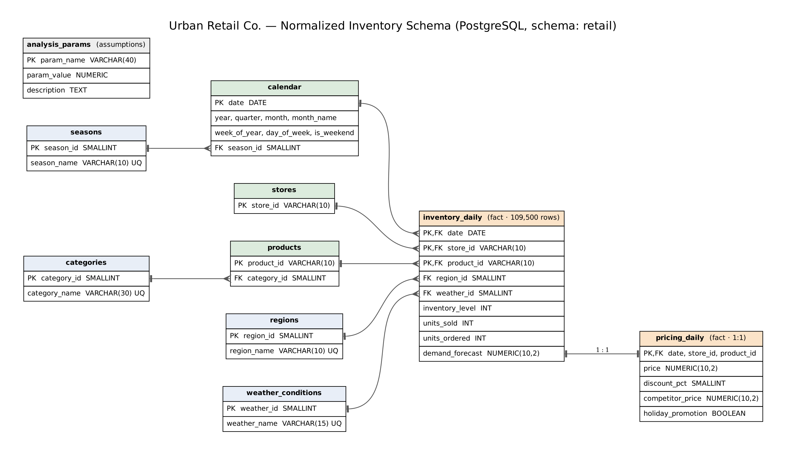

# Urban Retail Co. — Solving Inventory Inefficiencies with SQL

Consulting & Analytics Club, IIT Guwahati — Summer Projects '25.

A PostgreSQL project that turns a flat file of 109,500 daily inventory records
(5 stores × 30 products × 730 days, Jan 2022 – Dec 2023) into a normalized
database, a suite of inventory-analytics queries, a KPI dashboard and an
executive summary.

---

## Headline results

| KPI (2022–2023) | Value |
|---|---|
| Net revenue (after discounts) | 539.4M |
| Units sold | 10.59M |
| Stockout rate (days sales used up all stock) | 5.60% |
| At-risk rate (days forecast exceeded stock) | 14.86% |
| Days of supply | 1.51 |
| Annual inventory turnover | 242× |

**Top findings**

1. Promotions lift demand ~20% but stock only ~13% → stockouts rise from 5.5% to 6.4%.
2. Seasonality is category-specific: clothing +27% in winter, groceries +21% in summer.
3. Discounts (0–20%) show no volume lift but cost 43.9M (7.5% of gross revenue).
4. The demand forecast is biased high by 11.7% (MAPE 15.8%).
5. Overstock is small (~9K/yr holding cost); the real problem is peak-period understock.

---

## Repository layout

```
├── data/inventory_forecasting.csv      raw dataset
├── sql/
│   ├── 00_load_raw.sql                 load CSV into staging table
│   ├── 01_data_profiling.sql           data-quality checks that drive design decisions
│   ├── 02_schema_normalized.sql        3NF schema + population + v_daily view
│   ├── 03_core_inventory_queries.sql   stock levels, reorder point, low-stock alerts, turnover, KPIs
│   ├── 04_analytical_insights.sql      ABC/XYZ, overstock, lost sales, seasonality, promos,
│   │                                   discounts, forecast accuracy, supplier proxy, Q1-2024 forecast
│   ├── 05_performance_optimization.sql indexes + EXPLAIN ANALYZE before/after + materialized view
│   └── 06_dashboard_exports.sql        CSV exports feeding the dashboard
├── docs/erd.png | erd.svg | erd.dot    entity-relationship diagram
├── outputs/                            saved results of every script
│   └── dashboard_data/                 CSVs behind the KPI dashboard
└── run_all.sh                          rebuild everything in one command
```

---

## How to run

Requires PostgreSQL 13+ (`psql` on your PATH).

```bash
./run_all.sh                 # creates database "urban_retail" and runs 00 → 06
```

Or run scripts one by one from the repo root:

```bash
createdb urban_retail
psql -d urban_retail -f sql/00_load_raw.sql
psql -d urban_retail -f sql/01_data_profiling.sql
...
```

---

## Schema (3NF)



| Table | Grain | Why it exists |
|---|---|---|
| `inventory_daily` | date × store × product | Fact table: stock, sold, ordered, forecast |
| `pricing_daily` | date × store × product (1:1) | Price, discount, competitor price, promo flag — kept apart so stock queries scan a narrow table |
| `products` | product | Category depends only on product |
| `calendar` | date | Year, month, week, weekend, **season** (season depends only on month) |
| `stores`, `categories`, `regions`, `weather_conditions`, `seasons` | lookup | Replace repeated text with keys |
| `analysis_params` | parameter | Lead time, service level, holding cost — change assumptions without editing SQL |

`v_daily` re-joins everything into one readable row for analysts.

---

## Key definitions

| Metric | Formula |
|---|---|
| Stockout day | `units_sold >= inventory_level` |
| At-risk day | `demand_forecast > inventory_level` |
| Reorder point | `avg daily demand × lead time + z × σ(demand) × √lead time` (last 90 days) |
| Critical alert | latest stock < 1 day of average demand |
| Turnover (annual) | `avg daily units sold × 365 / avg inventory` |
| Days of supply | `avg inventory / avg daily units sold` (proxy for inventory age) |
| Lost sales | `max(bias-corrected forecast − stock, 0)` |
| ABC class | cumulative revenue share: A ≤ 70%, B ≤ 90%, C rest |

---

## Assumptions & data issues

- **Lead time = 1 day** — units ordered track units sold almost 1:1 every day (correlation 0.95), implying daily replenishment.
- **Service level 95%** (z = 1.65); **holding cost 25%/yr** of item value.
- **Inventory does not "flow"** (today ≠ yesterday − sold + ordered on 99.4% of rows) → each row is treated as an independent daily snapshot.
- **Units sold > stock on 5.1% of rows** — physically impossible; treated as a stockout signal.
- **Store region changes daily** (each store appears in all 4 regions) → region kept on the fact row, not on `stores`.
- **No supplier / lead-time / receipt-date columns** → supplier performance approximated by order-vs-sales consistency; inventory age by days of supply.

---

## Performance (from `outputs/05_performance_optimization.txt`)

| Query | Before | After | Change |
|---|---|---|---|
| One store-product time series | 6.8 ms (seq scan) | 0.26 ms (index-only) | ~26× |
| Latest stock per store-product | 207.6 ms | 23.0 ms | ~9× |
| One product, one quarter | 0.89 ms | 0.42 ms | ~2× |
| Monthly stockout KPI (dashboard) | 153 ms (raw joins) | 0.19 ms (materialized view) | ~800× |

Timings vary by machine; re-run script 05 to reproduce.
